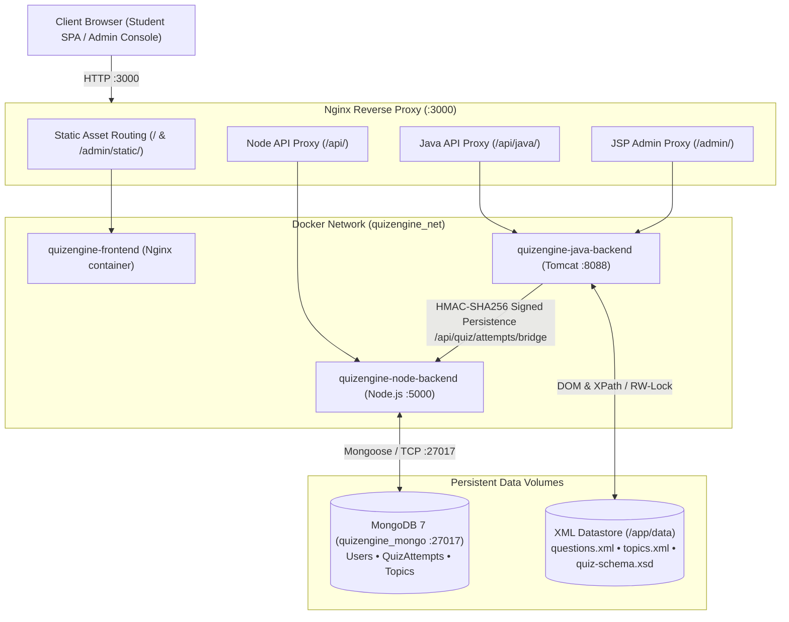
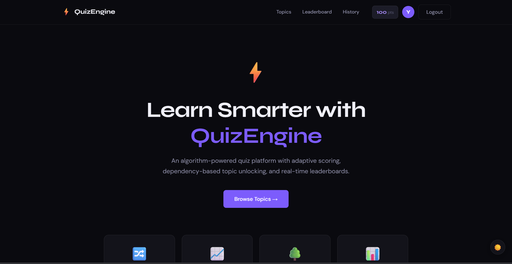
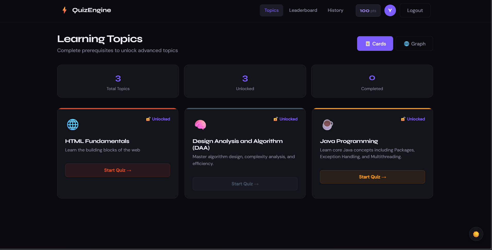
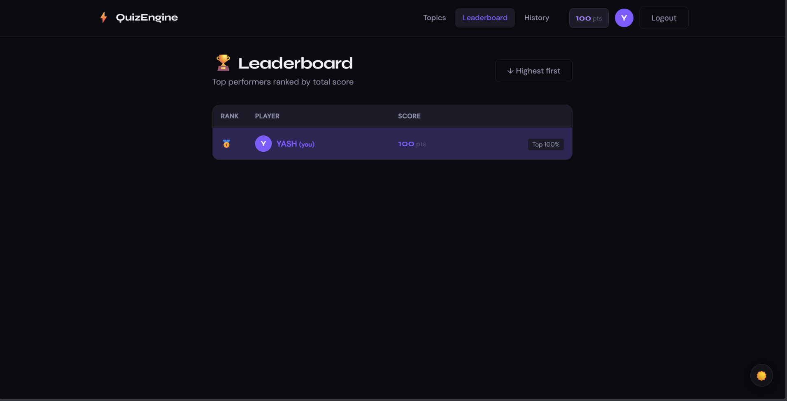

# ⚡ QuizEngine

<p align="center">
  <b>Enterprise Polyglot Quiz Platform & Evaluation Engine</b><br>
  <i>Adaptive Learning • Real-Time Scoring • Server-Side Evaluation • XML Datastore • JSP Admin Portal</i>
</p>

<p align="center">
  
  
  
  
  
  
  
  
</p>

---

## 📌 1. Project Overview

**QuizEngine** is a full-stack, polyglot quiz and evaluation platform engineered for high reliability, algorithmic integrity, and robust security.

It uniquely unifies:
- A responsive, modern single-page application built with **React 18** and custom design tokens.
- An authoritative user authentication, leaderboard, and attempt persistence service powered by **Node.js & Express** with **MongoDB**.
- A high-concurrency evaluation and datastore service built with **Java 17+, Jakarta Servlets 6.0, and Embedded Apache Tomcat 10.1**, backed by a schema-validated **XML/XSD datastore**.
- An enterprise dark-themed **JSP Admin Portal** for real-time datastore metrics, topic configuration, and full CRUD question management.
- An **Nginx reverse proxy** coordinating routing, API proxying, and static asset distribution under a unified entrypoint (`http://localhost:3000`).
- A cryptographic **HMAC-SHA256 Inter-Service Persistence Bridge** preventing attempt tampering and score inflation.

> [!NOTE]
> QuizEngine is configured for local multi-container execution using **Docker Compose** on Windows, Linux, and macOS. Cloud deployment is not required.

---

## ✨ 2. Key Features

- **Student Authentication & Session Security**: Secure registration, login, and password reset flows with JWT (JSON Web Tokens), bcrypt password hashing, and cryptographically random reset token generation.
- **Interactive Learning Tracks**: Structured topic cards covering **HTML Fundamentals**, **Java Programming**, and **Design Analysis and Algorithm (DAA)**, displaying target pass percentages (`60%`, `75%`, `70%`) with prominent action triggers.
- **Server-Side Quiz Evaluation**: Client answer submissions are evaluated strictly server-side against the authoritative XML repository; question payloads never leak correct answers or explanations to the browser.
- **Greedy Streak Scoring Engine**: Cross-layer scoring rules awarding `+4` points per correct answer, `-1` point per incorrect answer, `0` for timeouts (minimum score bounded at `0`), and streak multipliers (`+1` at 3 consecutive correct answers, `+2` at 5 consecutive correct answers).
- **Persistent Quiz History & Analytics**: Detailed attempt histories tracking questions answered, time spent, percentage scores, streak metrics, and pass/fail milestones.
- **Real-Time Leaderboard**: Global student rankings calculated dynamically with descending score prioritization and lexicographical tie-breaking.
- **Enterprise JSP Admin Portal**: Deep-navy administrative console (`/admin/dashboard`, `/admin/questions`, `/admin/topics`) featuring server health statistics, datastore reload counters, and XML inspection tools.
- **Schema-Validated XML Datastore**: Thread-safe XML repository protected with `ReentrantReadWriteLock` concurrency controls, atomic file persistence, XSD schema constraints, and hardened XXE/SSRF defenses.
- **Tamper-Proof HMAC Persistence Bridge**: Java-to-Node attempt persistence authenticated via canonical payload signing and constant-time SHA-256 signature verification.

---

## 🛠️ 3. Technology Stack

| Layer | Technologies |
| :--- | :--- |
| **Frontend SPA** | React 18, React Router v6, Axios, Syne & DM Sans typography, Custom CSS Design Tokens |
| **Node.js Backend** | Node.js (v20+), Express 4, Mongoose 8, `jsonwebtoken`, `bcryptjs`, native `crypto` |
| **Java Evaluation Service** | Java 17+, Jakarta Servlet 6.0, Embedded Apache Tomcat 10.1, Jackson Databind, DOM / XPath APIs |
| **Admin Webapp** | Jakarta Server Pages (JSP) 3.1, JSTL 3.0, Vanilla ES6 JavaScript, Custom Enterprise CSS |
| **Datastores** | MongoDB 7 (users, attempts, topics), XML 1.0 with W3C XML Schema (XSD) |
| **Infrastructure & Proxy** | Docker Compose v2, Nginx Alpine, Multi-stage Docker builds |

---

## 🏗️ 4. System Architecture



### Communication Flow:
1. **Student Interaction**: React SPA requests quiz questions via `/api/java/questions?topicId=:id`. Java retrieves and sanitizes questions from `questions.xml` (stripping answers) and returns them to the browser.
2. **Submission & Grading**: When the student completes the quiz, answers are submitted to `POST /api/java/quiz/evaluate`. Java grades against the authoritative XML store and computes score and streak metrics.
3. **Bridge Persistence**: Java constructs a canonical JSON evaluation payload, signs it using HMAC-SHA256 with `INTERNAL_SERVICE_SECRET`, and posts it to Node.js at `/api/quiz/attempts/bridge`.
4. **Authoritative Storage**: Node.js verifies the signature via `crypto.timingSafeEqual`, saves the attempt to MongoDB, updates the user's aggregate progress, and returns an acknowledgment.
5. **Admin Operations**: Administrators access `/admin/` through Nginx. The Java embedded Tomcat processes JSP requests, executes XML updates with strict locking, and coordinates with Node for admin authentication.

---

## 📸 5. Screenshots

<p align="center">
  <b>Student Home Experience</b><br>
  
</p>

<p align="center">
  <b>Interactive Quiz Interface</b><br>
  
</p>

<p align="center">
  <b>Global Leaderboard</b><br>
  
</p>

---

## 📁 6. Project Structure

```
quizengine/
├── assets/                               # Verified repository screenshot assets
│   ├── home.png
│   ├── leaderboard.png
│   └── quiz.png
├── backend/                              # Authoritative Node.js / Express Service
│   ├── algorithms/                       # Scoring, sorting, and graph utilities
│   │   ├── graph.js
│   │   ├── scoring.js
│   │   ├── shuffle.js
│   │   └── sorting.js
│   ├── config/                           # MongoDB connection configuration
│   │   └── db.js
│   ├── controllers/                      # Auth, quiz, topic, and leaderboard controllers
│   ├── middleware/                       # JWT auth, rate limiter, admin guard
│   ├── models/                           # Mongoose models (User, QuizAttempt, Topic, Question)
│   ├── routes/                           # Express route definitions
│   ├── tests/                            # Automated test suites and benchmarks
│   ├── .dockerignore
│   ├── .env.example
│   ├── Dockerfile
│   ├── package.json
│   └── server.js
├── frontend/                             # React 18 Single Page Application
│   ├── public/                           # HTML shell, favicon, manifest
│   ├── src/
│   │   ├── components/                   # Topic cards and UI navigation
│   │   │   ├── Graph/TopicCard.jsx
│   │   │   └── UI/Navbar.jsx
│   │   ├── context/AuthContext.jsx       # Client auth & session provider
│   │   ├── pages/                        # Home, Topics, Quiz, Results, Leaderboard, History
│   │   ├── styles/global.css             # Theme tokens and responsive design system
│   │   ├── utils/api.js                  # Axios client configuration
│   │   ├── App.jsx
│   │   └── index.jsx
│   ├── .dockerignore
│   ├── Dockerfile
│   ├── nginx.conf                        # Unified reverse proxy routing
│   └── package.json
├── java-backend/                         # Java Jakarta Servlet Backend & JSP Admin Service
│   ├── data/                             # XML questions, topics, and XSD schema
│   │   ├── questions.xml
│   │   ├── quiz-schema.xsd
│   │   └── topics.xml
│   ├── src/
│   │   ├── main/
│   │   │   ├── java/com/quizengine/
│   │   │   │   ├── dao/XmlQuestionDao.java
│   │   │   │   ├── model/
│   │   │   │   ├── security/AdminAuthFilter.java
│   │   │   │   ├── service/              # Evaluation, scoring, persistence bridge
│   │   │   │   ├── servlet/              # API and Admin servlet endpoints
│   │   │   │   └── Main.java             # Embedded Apache Tomcat bootstrap
│   │   │   └── webapp/                   # JSP views, admin.css, admin.js
│   │   └── test/java/com/quizengine/     # JUnit 5 & Mockito test suites
│   ├── .dockerignore
│   ├── Dockerfile
│   └── pom.xml
├── .env.example                          # Root environment template
├── .gitignore
├── docker-compose.yml                    # Multi-container orchestration specification
└── README.md
```

---

## ⚙️ 7. Prerequisites

Before starting, ensure the following software is installed on your system:

| Software | Minimum Version | Recommended | Notes |
| :--- | :--- | :--- | :--- |
| **Docker Desktop / Engine** | `24.0.0+` | Latest | WSL 2 backend on Windows |
| **Docker Compose** | `v2.20.0+` | Latest | Bundled with Docker Desktop |
| **Node.js** *(Optional for local dev)* | `v20.x LTS` | `v22.x LTS` | For running local backend scripts |
| **JDK** *(Optional for local dev)* | `Java 17` | `Java 21 LTS` | For compiling Java source directly |
| **Apache Maven** *(Optional)* | `3.9.0+` | `3.9.6+` | For standalone Java backend testing |

---

## 🚀 8. Local Installation and Startup

Follow these exact Windows PowerShell commands to start the entire QuizEngine platform locally:

```powershell
# 1. Clone the repository
git clone https://github.com/Rahul130405/Quiz-engine.git
cd Quiz-engine

# 2. Configure environment variables from template
Copy-Item .env.example .env

# 3. Validate Docker Compose configuration
docker compose config

# 4. Build and start all services in detached mode
docker compose up -d --build

# 5. Verify container health status
docker compose ps

# 6. Check service healthcheck endpoints
Invoke-RestMethod http://localhost:3000/api/health
Invoke-RestMethod http://localhost:3000/api/java/health

# 7. Open the application in your browser
Start-Process "http://localhost:3000"
```

---

## 🌐 9. Local URLs & Routing

All application services are unified behind the Nginx reverse proxy on port `3000`:

| Service / Interface | Local URL | Target Service | Purpose |
| :--- | :--- | :--- | :--- |
| **Student Web Application** | [http://localhost:3000/](http://localhost:3000/) | React SPA (Nginx) | Student landing page, authentication, results |
| **Learning Topics** | [http://localhost:3000/topics](http://localhost:3000/topics) | React SPA | 3-card learning portal (HTML, Java, DAA) |
| **Leaderboard** | [http://localhost:3000/leaderboard](http://localhost:3000/leaderboard) | React SPA | Real-time score rankings |
| **Quiz History** | [http://localhost:3000/history](http://localhost:3000/history) | React SPA | Student attempt history and review |
| **Admin Portal Login** | [http://localhost:3000/admin/login](http://localhost:3000/admin/login) | Java Tomcat (`:8088`) | Enterprise JSP administrative sign-in |
| **Admin Dashboard** | [http://localhost:3000/admin/dashboard](http://localhost:3000/admin/dashboard) | Java Tomcat (`:8088`) | Server status, reload counters, metrics |
| **Admin Questions Console** | [http://localhost:3000/admin/questions](http://localhost:3000/admin/questions) | Java Tomcat (`:8088`) | Question catalog, search, filter, CRUD |
| **Node.js Health Check** | [http://localhost:3000/api/health](http://localhost:3000/api/health) | Node.js (`:5000`) | Authoritative Node API status |
| **Java Service Health Check** | [http://localhost:3000/api/java/health](http://localhost:3000/api/java/health) | Java Tomcat (`:8088`) | XML datastore and Tomcat engine status |

---

## 🔒 10. Environment Variables

Environment variables are managed securely through `.env` files. Refer to [`.env.example`](file:///D:/QUIZENGINE/quizengine/.env.example) for placeholder definitions:

| Variable | Required By | Description | Example / Placeholder |
| :--- | :--- | :--- | :--- |
| `PORT` | Node.js | Internal Node API port | `5000` |
| `MONGODB_URI` | Node.js | MongoDB connection string | `mongodb://mongo:27017/quizengine` |
| `JWT_SECRET` | Node.js & Java | Secret key for signing student JWTs | `your_authoritative_jwt_secret_min_32_chars` |
| `JWT_EXPIRES_IN` | Node.js | Token lifespan | `7d` |
| `INTERNAL_SERVICE_SECRET` | Node.js & Java | HMAC secret for inter-service bridge | `your_dedicated_internal_service_secret_min_32_chars` |
| `ADMIN_REGISTRATION_SECRET`| Node.js | Secret key required to register admin | `your_admin_registration_passphrase_secret` |
| `NODE_ENV` | Node.js | Runtime mode (`development`/`production`)| `production` |
| `JAVA_PORT` | Java Backend | Embedded Tomcat port | `8088` |
| `NODE_API_URL` | Java Backend | Internal Node API target | `http://backend:5000/api` |
| `NODE_AUTH_URL` | Java Backend | Internal Node Auth endpoint | `http://backend:5000/api/auth/login` |
| `QUIZ_DATA_DIR` | Java Backend | Directory containing XML files | `/app/data` |
| `WEBAPP_DIR` | Java Backend | Directory containing JSP files | `/app/src/main/webapp` |

> [!WARNING]
> Never commit actual passwords, tokens, or JWT secrets to Git. Keep `.env` strictly untracked.

---

## 💾 11. Database & Persistence

QuizEngine uses a dual-datastore architecture designed for speed, schema flexibility, and strict validation:

### 1. MongoDB Service (`quizengine-mongo`)
- **Database**: `quizengine`
- **Collections**:
  - `users`: Student and administrator accounts, hashed credentials, and aggregate quiz points.
  - `quizattempts`: Immutable submission records, detailed answer choices, streak statistics, and pass/fail results.
  - `topics`: High-level topic identifiers and display preferences.
  - `questions`: Legacy auxiliary question storage.
- **Docker Storage**: Data is persisted in the Docker named volume `mongo_data` mounted at `/data/db`.

### 2. XML Datastore (`quizengine-java-backend`)
- **Authoritative Files**: `questions.xml` (60 questions across HTML, Java, DAA), `topics.xml`, `quiz-schema.xsd`.
- **Validation**: Strict W3C XML Schema validation enforcing question IDs, difficulty levels, options counts, and correct answers.
- **Concurrency**: Thread-safe reads and exclusive atomic writes using `java.util.concurrent.locks.ReentrantReadWriteLock` with `StandardCopyOption.ATOMIC_MOVE` to prevent file corruption.
- **Docker Storage**: Persisted in the Docker named volume `xml_data` mounted at `/app/data`.

> [!CAUTION]
> **PRESERVE YOUR DATA**: Never execute `docker compose down -v`. The `-v` flag permanently deletes the Docker volumes `mongo_data` and `xml_data`, wiping all user accounts, leaderboard points, and customized XML questions. Always stop containers with `docker compose down` or `docker compose stop`.

---

## 🛡️ 12. Admin Portal

The QuizEngine Admin Portal is a dedicated enterprise management console available at `http://localhost:3000/admin/login`:

- **Dual Authentication Modes**:
  1. **Standard Account Login**: Email and password authenticated through the backend authentication bridge.
  2. **Direct JWT Token Bridge**: Paste an existing administrator JWT token for instant session generation.
- **Administrative Capabilities**:
  - **Dashboard Metrics**: Live count of XML questions, active topics, last datastore reload timestamp, and JVM memory utilization.
  - **Question Management**: Full CRUD operations on XML questions. Filter by topic (HTML, Java, DAA), search question text, edit options, update correct answer indices, and add new questions with automatic XSD validation.
  - **Topic Overview**: Review topic display orders, icons, and required passing marks.

---

## 📡 13. API Documentation

### Node.js REST API (`/api/`)
| Method | Endpoint | Access | Description |
| :--- | :--- | :--- | :--- |
| `POST` | `/api/auth/register` | Public | Register new student account |
| `POST` | `/api/auth/login` | Public | Authenticate user & issue JWT |
| `POST` | `/api/auth/forgot-password` | Public | Generate password reset token |
| `POST` | `/api/auth/reset-password` | Public | Reset password with token |
| `GET` | `/api/topics` | Public | Retrieve topics list |
| `GET` | `/api/leaderboard` | Public | Retrieve global student rankings |
| `GET` | `/api/quiz/history` | Authenticated | Retrieve authenticated user's attempt history |
| `POST` | `/api/quiz/attempts/bridge` | Inter-Service | HMAC-signed Java attempt persistence |
| `GET` | `/api/health` | Public | Node.js service health status |

### Java Servlet API (`/api/java/`)
| Method | Endpoint | Access | Description |
| :--- | :--- | :--- | :--- |
| `GET` | `/api/java/topics` | Public | Fetch topics from XML datastore |
| `GET` | `/api/java/questions` | Public | Get randomized sanitized questions (`topicId`, `count`) |
| `POST` | `/api/java/quiz/evaluate` | Authenticated | Submit answers for server-side evaluation & grading |
| `GET` | `/api/java/health` | Public | Java Tomcat & XML datastore health status |

---

## 🧪 14. Testing & Verification

QuizEngine includes comprehensive automated tests covering unit logic, integration parity, and end-to-end user workflows:

### 1. Node.js Unit & Integration Tests
```powershell
# Run core Phase 1 tests (Token generation, question sanitization, leaderboard sorting)
node backend/tests/test_phase1.js
# Verified: 7 / 7 PASSED

# Run greedy scoring engine tests (Streaks, bonuses, timeouts)
node backend/tests/test_scoring.js
# Verified: 4 / 4 PASSED

# Run cross-layer scoring parity verification
node backend/tests/test_scoring_cross_layer.js
```

### 2. Java Backend Tests (Maven)
```powershell
cd java-backend
mvn clean test
# Runs XmlQuestionDaoTest, ScoringServiceTest, QuizEvaluationServiceTest, AdminAuthTest
```

### 3. Frontend Build Verification
```powershell
cd frontend
npm run build
# Compiles optimized production bundle without warnings or errors
```

### 4. End-to-End Browser & Security Verification
```powershell
node backend/tests/test_browser_acceptance.js
node backend/tests/test_phase6_security_closure.js
```

---

## 🔐 15. Security Architecture

1. **Answer Masking & Zero-Trust Client Payloads**: Quiz questions sent to the frontend strictly omit the `correctAnswer` and `explanation` fields. Grading occurs exclusively on the Java backend.
2. **HMAC-SHA256 Inter-Service Bridge**: Java signs submission payloads using HMAC-SHA256 with `INTERNAL_SERVICE_SECRET`. The Node.js receiver validates the digest using constant-time comparison (`crypto.timingSafeEqual`) to prevent timing attacks.
3. **Hardened XML Parser (XXE & SSRF Protection)**: The `XmlQuestionDao` parser disables external general entities (`external-general-entities: false`), external parameter entities (`external-parameter-entities: false`), and DTD declarations (`disallow-doctype-decl: true`).
4. **Password Security**: Passwords are encrypted using `bcrypt` with salt rounds set to 10. Password reset tokens use cryptographically secure random bytes (`crypto.randomBytes(32)`), stored as SHA-256 hashes with short-lived expiration windows.
5. **Rate Limiting & Brute-Force Defense**: Sliding window rate limiters restrict excessive authentication attempts and prevent automated denial of service.

---

## 🔧 16. Troubleshooting

- **MongoDB Fails to Start**:
  - Run `docker compose logs mongo` to check logs. Ensure host port `27017` is not already occupied by another local MongoDB service.
- **502 Bad Gateway from Nginx**:
  - Run `docker compose ps` to ensure both `quizengine-node-backend` and `quizengine-java-backend` are in `(healthy)` status.
- **Admin Portal Styles Missing**:
  - Verify Nginx is routing static assets with high-priority location blocks: `^~ /admin/static/` and `^~ /static/css/admin.css`. Perform a hard browser refresh (`Ctrl+F5` or `Cmd+Shift+R`).
- **Cannot Start Containers**:
  - Run `docker compose down` (without `-v`) and rerun `docker compose up -d --build`.

---

## 🗺️ 17. Roadmap & Future Enhancements

- [ ] **Multi-Topic Mock Exams**: Generate composite exams combining questions across HTML, Java, and DAA.
- [ ] **Exportable PDF Certificates**: Provide downloadable performance certificates upon passing with a grade above 85%.
- [ ] **Code Snippet Highlighting**: Integrated Monaco/CodeMirror syntax highlighting for programming questions.
- [ ] **WebSocket Live Leaderboard**: Real-time push updates for competitive classroom quiz events.

---

## 📄 18. License

This project is licensed under the **MIT License**.
